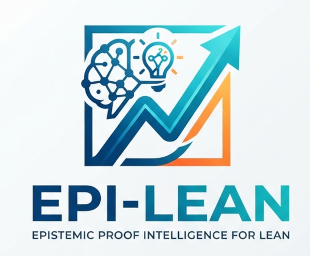

<p align="center">
  
</p>
**An open-source research framework for auditing the epistemic structure of formally verified mathematical proofs.**

[](LICENSE)
[](https://www.python.org/)
[]()
[](https://lean-lang.org/)

---

## 1. Overview

EPI-LEAN (Epistemic Proof Intelligence for Lean) is an open-source research project investigating how the epistemic structure of formally verified mathematical proofs can be analyzed, reconstructed, and audited.

The project focuses on a question that goes beyond formal proof verification:

**When a mathematical theorem has been formally verified, how can we inspect whether the mathematical meaning of its definitions, assumptions, intermediate results, and transformations remains traceable throughout the proof?**

Modern proof assistants such as Lean provide a rigorous foundation for formal verification. They make it possible to check whether a proposition follows from a set of formal assumptions according to a precise logical framework.

However, formal correctness and semantic adequacy are different questions.

A proof assistant can verify a formal derivation without independently establishing that every formal definition, abstraction, or translation faithfully represents the intended mathematical concept.

EPI-LEAN aims to provide an additional layer of analysis over formal proof developments.

It is designed to help researchers investigate:

- Formal dependency structures.
- Axiom and assumption provenance.
- Mathematical meaning associated with formal declarations.
- Semantic correspondence between definitions and intermediate results.
- Preservation of mathematical meaning across proof transformations.
- Traceability of mathematical arguments.
- Gaps between formal derivation and mathematical explanation.

EPI-LEAN does not replace Lean or its kernel. Instead, it investigates how formal verification can be complemented by explicit epistemic analysis.

---

## 2. The Problem

Formal verification has significantly improved the reliability of mathematical proofs.

In Lean, a theorem is represented as a formal declaration supported by definitions, assumptions, and proof terms. The trusted kernel checks whether the proof term has the required type.

This provides a strong guarantee of formal correctness within the underlying logical framework.

Nevertheless, several distinct questions remain.

### 2.1 Formal correctness

Does the theorem follow from its formal premises?

This is the question addressed by Lean's kernel.

### 2.2 Semantic adequacy

Do the formal definitions and propositions correctly represent the intended mathematical concepts?

This requires examining the relationship between the formal representation and the mathematics it is intended to express.

### 2.3 Epistemic traceability

Can we reconstruct how the mathematical meaning of the original concepts is connected to the formal declarations and intermediate results throughout the development?

For example:

- Does an intermediate definition preserve the intended mathematical meaning?
- Does a later theorem rely on a result whose interpretation has changed?
- Are assumptions clearly identifiable throughout the dependency structure?
- Can a formal declaration be connected to its intended mathematical interpretation?
- Are the mathematical reasons behind a transformation documented and justified?

These questions become particularly relevant in large formal developments, where definitions and theorems may be distributed across many files and interconnected through complex dependency structures.

EPI-LEAN investigates methods for making these relationships more explicit and auditable.

---

## 3. Core Objective

The main objective of EPI-LEAN is to develop a framework that combines formal dependency analysis with semantic and epistemic traceability.

The project seeks to answer five central questions:

1. **What is formally established?**  
   Which declarations, definitions, theorems, and axioms are present in the Lean development?

2. **What does each declaration mean?**  
   What mathematical concept or proposition is represented by each formal declaration?

3. **Where do assumptions originate?**  
   Which assumptions and axioms support a given theorem, directly or transitively?

4. **Is mathematical meaning preserved?**  
   Can the correspondence between mathematical concepts and formal representations be traced across intermediate definitions and transformations?

5. **What remains epistemically unresolved?**  
   Which interpretations, semantic correspondences, or mathematical explanations require further investigation?

The long-term goal is to make the epistemic structure of formalized mathematics more transparent, reproducible, and independently auditable.

---

## 4. Fundamental Principles

EPI-LEAN is guided by six principles.

### Principle 1 — Formal correctness is not semantic adequacy

A formally verified derivation does not automatically establish that its formalization captures the intended informal mathematics.

These properties must be examined separately.

### Principle 2 — Mathematical interpretations require traceable evidence

Every semantic interpretation should be associated with supporting evidence, such as:

- A mathematical definition.
- A reference to a mathematical publication.
- A correspondence with an established concept.
- A documented translation between informal and formal statements.
- A human review record.

### Principle 3 — Formal and semantic dependencies must remain distinct

Formal dependencies describe which declarations are used by other declarations.

Semantic relationships describe how mathematical concepts correspond to formal representations.

These structures are related, but they are not interchangeable.

### Principle 4 — AI-generated interpretations are proposals

Artificial intelligence may help identify concepts, suggest correspondences, explain transformations, and propose potential inconsistencies.

However, an AI-generated interpretation must not automatically become a verified mathematical fact.

Formal claims require formal checking where applicable, and semantic claims require evidence and appropriate human review.

### Principle 5 — Non-interference with formal verification

EPI-LEAN does not invalidate, modify, override, or replace the formal
verification status established by Lean. Its assessments are
complementary epistemic evaluations and must remain explicitly
distinguishable from formal proof validity.

Concretely: an audit never modifies the analyzed Lean files, never
alters kernel results, never turns a semantic warning into a formal
error, and every report carries an explicit `formal_verification` block.
So a proof that Lean accepts can never become "invalid" because of an
EPI-LEAN assessment — at most, its *claimed mathematical meaning* is
flagged as needing human review.

### Principle 6 — Epistemic assessments must be auditable

The origin of an interpretation, its supporting evidence, its review status, and its relationship to formal declarations should be inspectable and reproducible.

---

## 5. Architecture

EPI-LEAN is designed as a modular framework.

Its intended architecture separates formal extraction, semantic analysis, logical auditing, epistemic assessment, and reporting.

### 5.1 Formal Extraction

Extracts information from Lean projects, including:

- Declaration names.
- Declaration types and categories.
- Source locations.
- Dependencies between declarations.
- Declared axioms and assumptions.

The initial prototype uses source-level analysis. A future implementation will integrate more deeply with Lean 4's elaborated environment.

### 5.2 Formal Dependency Analysis

Constructs a directed graph representing relationships between formal declarations.

This graph can be used to investigate:

- Direct dependencies.
- Transitive dependencies.
- Dependency chains.
- Axiom provenance.
- The structure of large proof developments.

A formal proof development is generally a directed dependency graph rather than a simple linear sequence. EPI-LEAN therefore treats dependencies as a graph.

### 5.3 Semantic Analysis

Associates formal declarations with explicit mathematical interpretations.

For example, a Lean declaration may correspond to:

- A mathematical definition.
- A proposition.
- A theorem about an established mathematical structure.
- An intermediate result.
- A technical construction used in a formal proof.

Semantic interpretations are stored separately from the formal dependency graph.

### 5.4 Logical and Assumption Auditing

Investigates the assumptions supporting formal declarations.

The goal is to identify the provenance of assumptions and make the dependency closure of a theorem more transparent.

The initial implementation tracks declarations explicitly marked as axioms. A future Lean-aware implementation should also account for the complete trusted environment and relevant imported assumptions.

### 5.5 Epistemic Auditing

The epistemic auditor is the central research component of EPI-LEAN.

Its intended responsibilities include:

- Evaluating semantic traceability.
- Identifying undocumented mathematical correspondences.
- Tracking meaning-preservation obligations.
- Detecting gaps in mathematical explanations.
- Highlighting potentially ambiguous or insufficiently justified transformations.
- Recording unresolved semantic questions.

These capabilities are research objectives; they are not all implemented in the current prototype.

### 5.6 Hybrid Research Engine

A future hybrid engine will allow AI systems to propose:

- Mathematical interpretations.
- Semantic relationships.
- Possible missing assumptions.
- Explanations of intermediate results.
- Potential inconsistencies.
- Candidate counterexamples or proof obligations.

The proposed information will be subject to explicit validation and review.

AI systems will not be allowed to certify their own mathematical interpretations.

### 5.7 Audit Reports

EPI-LEAN aims to produce reproducible reports containing:

- Extracted declarations.
- Formal dependency information.
- Axiom provenance.
- Semantic registry entries.
- Review status.
- Warnings and unresolved questions.

---

## 6. Two Complementary Graphs

One of the central architectural decisions in EPI-LEAN is to maintain two different graphs.

### Formal Dependency Graph

Represents the relationships between formal declarations.

For example:

```text
Foundational Axiom
        |
        v
Intermediate Lemma
        |
        v
Main Theorem
```

This graph answers:

**Which formal declarations support a given declaration?**

### Semantic Graph

Represents the mathematical interpretation of formal declarations and their relationships.

For example:

```text
Mathematical Concept A
        |
        v
Formal Definition A
        |
        v
Intermediate Mathematical Result
        |
        v
Formal Theorem B
```

This graph answers:

**How are the mathematical concepts represented and connected throughout the formal development?**

The two graphs should be linked through explicit correspondence records, but they must never be treated as equivalent.

A dependency edge does not, by itself, establish a semantic relationship.

---

## 7. Current Implementation

The current release, **v0.2.0**, provides a Python-based research
prototype with **two extraction modes**:

1. **Source-level (heuristic)** — regex-based extraction from `.lean`
   files. Fast, no Lean toolchain needed, but approximate: it can miss
   guillemet names (`«théorème»`), anonymous instances, namespaced
   collisions, and proof-term references.
2. **Elaborated-environment (exact)** — `tools/EpiDump.lean`, a
   self-contained Lean metaprogram (Lean 4.15, no Mathlib dependency),
   dumps the *elaborated* environment of a compiled project to JSONL:
   exact declaration names, exact direct dependencies (including
   proof-term and instance references), and per-declaration axiom
   provenance computed by Lean's own `collectAxioms` (kernel-level,
   transitive). This is the mode to use for real projects, including
   Mathlib-scale ones.

### Implemented features

- Recursive discovery of Lean source files (source mode).
- Extraction of common declaration forms (including `@[attribute]`
  annotations, `partial`/`protected`/`private`/`noncomputable`/`unsafe`
  modifiers, and named `instance` declarations) (source mode).
- **Elaborated-environment dumps via `tools/EpiDump.lean`** (exact mode):
  `--dump` audits an existing JSONL dump; `--lake` builds the dump for
  every module of a compiled lake project and audits the combined
  result.
- **Exact axiom provenance** in exact mode: Lean's `collectAxioms`
  closure per declaration, kernel-computed.
- Construction of a formal dependency graph.
- Calculation of transitive dependencies.
- Identification of explicitly declared axioms in dependency closures.
- **Axiom provenance histogram** in every report: how many
  declarations' closures contain each axiom (e.g. for
  `Mathlib.Data.Set.Basic`: `propext` 394, `Quot.sound` 387,
  `Classical.choice` 295 — real numbers, kernel-computed).
- **Scale features (0.2.1)**: compiler/elaborator artifacts
  (`_auxLemma.N`, `match_N`, `proof_N`, `eq_N`, `_elambda_N`) are
  excluded by default and the graph is *contracted* through them
  (no reachability lost); transitive closure is computed with
  SCC condensation + bitsets (`--closure full|count|none|auto`); a
  **dependency frontier** summarizes which constants outside the
  audited modules (e.g. Mathlib) the project relies on; `--lake`
  dumps modules in parallel (`--jobs`) with a fingerprinted cache;
  `epilean why` explains which dependency chain brings an axiom into a
  declaration.
- **AI layer (experimental, opt-in)**: `epilean propose` asks a model
  to *propose* registry entries and `epilean supervise` runs
  deterministic checks plus an optional AI second review. Models are
  reached through a provider-agnostic interface (Anthropic,
  OpenAI-compatible/local, record/replay), every exchange goes into a
  hash-chained trail (`epilean verify-trail`), and the guardrails of
  Principle 4 are enforced in code. See `docs/AI_SUPERVISION.md`.
- **Large-report handling**: markdown tables truncate above 60
  declarations (head + tail with an explicit omission marker); the
  JSON report always carries everything.
- Loading and validation of a JSON semantic registry, with warnings for
  duplicates, empty fields, `reviewed` entries without evidence, and AI
  proposals marked `reviewed` (auto-downgraded).
- **Epistemic assessment layer**: per-declaration epistemic statuses
  (`SEMANTICALLY_SUPPORTED`, `POTENTIAL_MISMATCH`, `REVIEW_REQUIRED`,
  `INSUFFICIENT_EVIDENCE`) with independent observation, evidence, and
  `human_review_required` fields.
- **Non-interference block** in every report: EPI-LEAN states it does
  not invoke the Lean kernel and never changes Lean's verdicts.
- JSON audit reports.
- Markdown audit reports with an epistemic summary table.
- Command-line interface with `--version`.
- A JSON Schema for the semantic registry.
- Three worked examples with generated audit reports.
- Automated Python tests (including a lake end-to-end integration
  test and a negative control showing what source mode misses).
- Continuous integration workflow.

### Supported declaration forms

The extractor recognizes common forms such as:

- `theorem`
- `lemma`
- `def`
- `abbrev`
- `axiom`
- `opaque`
- `structure`
- `inductive`
- `class`
- `instance` (named instances)

Optional leading `@[attribute]` annotations and modifiers
(`private`, `protected`, `noncomputable`, `partial`, `unsafe`) are
skipped when locating the keyword and name.

This is a source-level heuristic, not a complete Lean parser.

### Epistemic assessment statuses

Because epistemic assessments must never be confused with Lean's formal
verdicts, EPI-LEAN never uses `valid`/`invalid`. It reports one of four
independent statuses per declaration:

| Status | Meaning |
|---|---|
| `SEMANTICALLY_SUPPORTED` | A human review of the interpretation has been recorded (workflow annotation, not a machine-verified claim). |
| `POTENTIAL_MISMATCH` | The interpretation is a proposal; a mismatch between claimed and formal content cannot yet be excluded. |
| `REVIEW_REQUIRED` | The interpretation is under review; no conclusion until it completes. |
| `INSUFFICIENT_EVIDENCE` | No registry entry; the prototype cannot infer meaning from syntax. |

Declarations flagged `POTENTIAL_MISMATCH` are exactly what
`examples/semantic-mismatch/` illustrates: a proof Lean may accept
perfectly, whose *claimed meaning* still deserves human review.

### Current limitations

The current version does not:

- Invoke Lean's kernel.
- Prove semantic equivalence between definitions.
- Automatically determine the intended meaning of a declaration.
- Establish that an informal theorem is faithfully represented.
- Certify the epistemic adequacy of a mathematical proof.

The AI layer does not make a model an authority: its output is
labeled unverified, cannot set `reviewed`, and cannot change a
deterministic finding. Proposals made from names and dependencies alone
(the current dump carries no statement text) are weak; see
`docs/AI_SUPERVISION.md`.

Source mode additionally does not guarantee complete dependency
extraction (it is a heuristic); use `--lake`/`--dump` (exact mode) for
real projects. Exact mode requires a compiled project (`lake build`) and
a `lean` binary on PATH.

---

## 8. Installation

### Requirements

- Python 3.10 or newer.
- Git.
- A Lean 4 installation for working with Lean projects.

The current Python prototype does not require Lean to run its source-level analysis.

### Clone the repository

```bash
git clone https://github.com/justo-tapiador/epi-lean.git
cd epi-lean
```

Replace `justo-tapiador` with the GitHub account hosting the repository.

### Create a virtual environment

```bash
python -m venv .venv
```

Activate it:

Linux or macOS:

```bash
source .venv/bin/activate
```

Windows PowerShell:

```powershell
.venv\Scripts\Activate.ps1
```

### Install EPI-LEAN

```bash
python -m pip install --upgrade pip
python -m pip install -e ".[dev]"
```

### Run the tests

```bash
pytest
```

---

## 9. Basic Usage

EPI-LEAN provides a command-line interface.

### Audit a Lean project

```bash
epilean audit path/to/lean-project
```

By default, the report is displayed in Markdown.

### Generate a JSON report

```bash
epilean audit path/to/lean-project --format json
```

### Save a Markdown report

```bash
epilean audit path/to/lean-project \
  --format markdown \
  --output audit-report.md
```

### Save a JSON report

```bash
epilean audit path/to/lean-project \
  --format json \
  --output audit-report.json
```

### Include a semantic registry

```bash
epilean audit path/to/lean-project \
  --semantic-registry path/to/semantic_registry.json
```

The semantic registry provides explicit interpretations associated with Lean declarations.

Its machine-readable contract is
[`schemas/semantic-registry.schema.json`](schemas/semantic-registry.schema.json)
(JSON Schema 2020-12).

### Audit a compiled lake project (exact mode)

```bash
cd path/to/lake-project
lake build                      # if not already built
epilean audit . --lake --format markdown --output audit-report.md
```

This discovers every module under `.lake/build/lib`, runs the EPI-LEAN
dump metaprogram (`tools/EpiDump.lean`) on each, and audits the
combined elaborated environment: exact names, exact dependencies, and
Lean-computed axiom provenance per declaration. Requires `lean` on
PATH.

To audit specific modules only:

```bash
epilean audit . --lake --module MyProject.Basic --module MyProject.Core
```

For large projects:

```bash
epilean audit . --lake --jobs 4 --closure count --format json --output report.json
```

`--jobs N` runs N Lean processes at once (each loads its module's
imports, so memory grows with N). The combined dump is cached under
`.lake/epilean-cache/`, keyed by a fingerprint of the Lean version, the
dump program, the module list and every `.olean`; re-auditing an
unchanged project (e.g. after editing the semantic registry) runs no
Lean at all. `--no-cache` disables it. `--closure` controls how
transitive dependencies are reported (`auto` = full lists up to 2,000
declarations, counts up to 50,000, none beyond).

To see why a declaration depends on an axiom:

```bash
epilean why dump.jsonl Set.sep_eq_of_subset propext
```

### Audit an existing dump (exact mode)

```bash
epilean audit dump.jsonl --dump --format json
```

Use this when the dump was produced separately (e.g. manually with
`lake env lean --run tools/EpiDump.lean -- out.jsonl My.Module`).

### Auditing Mathlib modules

With Mathlib's olean cache in place (a shallow clone plus
`lake exe cache get`), individual Mathlib modules audit directly:

```bash
lake env lean --run tools/EpiDump.lean -- set-basic.jsonl Mathlib.Data.Set.Basic
epilean audit set-basic.jsonl --dump --format json
```

Verified on Mathlib at tag `v4.15.0`: `Mathlib.Data.Set.Basic` dumps
736 constants, of which 168 are compiler/elaborator artifacts and are
excluded by default, leaving 568 declarations with kernel-computed
axiom provenance — `propext` appears in 394 declarations' closures,
`Quot.sound` in 387, and `Classical.choice` in 295.
`Mathlib.Algebra.Group.Basic` dumps 492 constants (436 after
filtering). Before 0.2.1 the raw 736 and the unfiltered histogram
(530/465/349) were reported, and two `_elambda_N` compiler constants
were counted as project axioms; `--include-internal` reproduces the old
view.

---

## 10. Semantic Registry

The semantic registry is a key element of the EPI-LEAN architecture.

It records the mathematical interpretations associated with formal declarations.

A registry is a JSON document containing an `entries` array.

Example:

```json
{
  "entries": [
    {
      "declaration": "my_theorem",
      "interpretation": "A mathematical proposition concerning ...",
      "status": "under_review",
      "evidence": "Correspondence with the mathematical definition in Section 2."
    }
  ]
}
```

Each entry contains:

| Field | Description |
|---|---|
| `declaration` | Lean declaration name |
| `interpretation` | Mathematical interpretation |
| `status` | Review status |
| `evidence` | Supporting evidence or documentation |
| `origin` | Optional: `human` (default) or `ai_proposal` |
| `reviewed_by`, `reviewed_at` | Optional: reviewer identity and date for `reviewed` entries |
| `references` | Optional: pointers to literature or documentation |

Entries that are `reviewed` must supply `evidence`; the loader
downgrades them otherwise. AI proposals (`origin: ai_proposal`) can
never be `reviewed`: the loader downgrades and warns.

### Review statuses

EPI-LEAN defines three initial statuses:

- `proposed`: an interpretation has been suggested but not reviewed.
- `under_review`: the interpretation is being examined.
- `reviewed`: a human review has been recorded.

The `reviewed` status is a workflow annotation. It does not mean that EPI-LEAN has mathematically verified the interpretation.

This distinction is essential for maintaining epistemic transparency.

---

## 11. Examples

### Example 00 — Basic dependency chain (`examples/basic/`)

```lean
namespace EpiLeanExample

axiom foundational_assumption : True

theorem intermediate_result : True :=
  foundational_assumption

theorem final_result : True :=
  intermediate_result

end EpiLeanExample
```

Both repository examples elaborate cleanly with Lean 4 core alone
(verified with Lean 4.15.0; no Mathlib needed).

The example illustrates a dependency chain:

```text
foundational_assumption
          |
          v
intermediate_result
          |
          v
final_result
```

EPI-LEAN can identify the declarations and report the explicitly declared axiom in the transitive dependency closure of `final_result`.

This example is intentionally simple. It demonstrates the mechanics of the prototype rather than a substantive mathematical result.

To run the example:

```bash
epilean audit examples/basic \
  --semantic-registry examples/basic/semantic_registry.json
```

The generated report is committed as
[`examples/basic/audit-report.md`](examples/basic/audit-report.md).

### Example 01 — Semantic mismatch (`examples/semantic-mismatch/`)

The repository also includes the motivating example for the epistemic
layer: a definition named `IsSquareNonnegative` whose body is
`0 ≤ x + x` — nonnegativity of the *double*, not the *square* — and a
theorem whose conclusion restates its own hypothesis. Lean can accept
both perfectly; what EPI-LEAN flags is that the *claimed meaning* does
not match the formal content.

The example is self-contained (Lean 4 core only, no Mathlib), so it
elaborates without external dependencies. Files:

- [`SemanticMismatch.lean`](examples/semantic-mismatch/SemanticMismatch.lean) — the Lean source.
- [`semantic_registry.json`](examples/semantic-mismatch/semantic_registry.json) — interpretations, all `proposed` except the honest theorem.
- [`audit-report.md`](examples/semantic-mismatch/audit-report.md) — the generated report: `POTENTIAL_MISMATCH` for the mismatching declarations, `SEMANTICALLY_SUPPORTED` for the honest one.
- [`README.md`](examples/semantic-mismatch/README.md) — full discussion of the example.

Run it:

```bash
epilean audit examples/semantic-mismatch \
  --semantic-registry examples/semantic-mismatch/semantic_registry.json
```

### Example 02 — Compiled lake project, tricky syntax (`examples/lake-project/`)

A real lake project whose declarations are chosen to break the
source-level regex extractor, audited in exact (elaborated) mode:

- `«théorème»` and `«tête»` — guillemet (unicode) names.
- An anonymous `instance : Inhabited Nat` and a named one (`instCos`).
- `Inner.helper` and `Outer.helper` — the same short name in two
  namespaces (a source-level name collision).
- `secret_axiom` — an axiom used only *inside a proof term*, invisible
  to statement-level heuristics.
- `classical_use` — a proof using `Classical.em`, whose closure
  includes `Classical.choice`, `propext`, and `Quot.sound`.

Run it (requires a Lean 4 toolchain):

```bash
cd examples/lake-project
lake build
epilean audit . --lake --format json
```

The elaborated audit recovers all 9 user declarations with exact names
and exact axiom provenance (`théorème` → `secret_axiom`;
`classical_use` → the three standard axioms). The negative control —
running the same project in source mode — is part of the test suite:
the heuristic extractor demonstrably misses the guillemet names and the
namespaced collisions, which is precisely why the elaborated mode
exists.

### What an audit report looks like

Every report states that EPI-LEAN did **not** invoke the Lean kernel,
carries the non-interference note, and separates formal facts from
epistemic assessments:

```text
## Formal verification status

- System: Lean
- Status: `NOT_CHECKED`

EPI-LEAN does not invalidate, modify, override, or replace ...

## Epistemic summary

| Epistemic status | Count |
|---|---|
| supported (`SEMANTICALLY_SUPPORTED`) | 1 |
| potential mismatch (`POTENTIAL_MISMATCH`) | 2 |
...
```

---

## 12. Research Methodology

EPI-LEAN is a research project, not merely a source-code analysis utility.

Its methodology is based on the separation of three dimensions.

### Formal correctness

The correctness of the formal derivation under Lean's logical framework.

### Semantic adequacy

The correspondence between formal definitions and the mathematical concepts they are intended to represent.

### Explanatory understanding

The ability to reconstruct and communicate the mathematical reasoning and relationships underlying the formal development.

The project investigates how these dimensions can be examined together without confusing their respective guarantees.

### Potential evaluation criteria

Future versions may be evaluated using:

1. Accuracy of extracted formal dependencies.
2. Completeness of assumption provenance.
3. Quality of semantic correspondence records.
4. Reproducibility of epistemic audit reports.
5. Agreement between independent mathematical reviewers.
6. Identification of unresolved meaning-preservation obligations.

---

## 13. Roadmap

EPI-LEAN is being developed incrementally.

| Version | Planned capabilities |
|---|---|
| `0.1.x` | Source-level extraction, dependency graph, axiom provenance, semantic registry, epistemic statuses, non-interference reports |
| `0.2.0` | Lean-aware extraction from elaborated environments |
| `0.2.1` | Scale hardening (internal-artifact contraction, closure statistics, frontier, parallel cached dumps) and an experimental AI proposal/supervision layer *(current)* |
| `0.3.0` | Semantic contracts and correspondence obligations |
| `0.4.0` | Epistemic traceability and meaning-preservation analysis |
| `0.5.0` | AI-assisted research with human review |
| `0.6.0` | Reproducible epistemic audit certificates |
| `1.0.0` | Stable research framework |

The roadmap is indicative and may change as the research develops.

---

## 14. Relationship with Lean and Mathlib

EPI-LEAN is designed to complement the Lean theorem prover and its mathematical ecosystem.

- **Lean** provides the formal language, elaboration process, and trusted kernel.
- **Mathlib** provides a large library of formalized mathematics.
- **EPI-LEAN** investigates the epistemic traceability of mathematical meaning, assumptions, and relationships in formal developments.

The project does not intend to replace Lean's proof-checking mechanisms.

Instead, it aims to make the mathematical structure surrounding formal proofs more transparent.

Relevant resources:

- [Lean Programming Language](https://lean-lang.org/)
- [Lean Documentation](https://lean-lang.org/doc/)
- [Mathlib](https://github.com/leanprover-community/mathlib4)

---

## 15. Contributing

EPI-LEAN welcomes contributions from researchers and developers interested in:

- Formal verification.
- Mathematical logic.
- Proof assistants.
- Philosophy and epistemology of mathematics.
- Automated reasoning.
- Artificial intelligence and mathematics.
- Scientific software engineering.

Potential contributions include:

- Lean extraction backends.
- Dependency-analysis improvements.
- Semantic registry extensions.
- Mathematical case studies.
- Evaluation datasets.
- Documentation.
- Testing and reproducibility tools.

Please read [CONTRIBUTING.md](CONTRIBUTING.md) before submitting a contribution.

---

## 16. Scientific Scope and Limitations

EPI-LEAN is an experimental research framework.

Its central research question remains open:

**Can we develop systematic and reproducible methods for auditing the preservation and traceability of mathematical meaning throughout formally verified proofs?**

The project does not assume that every semantic relationship can be reduced to a machine-checkable property.

Some mathematical interpretations require human judgment, contextual knowledge, and mathematical expertise.

EPI-LEAN therefore adopts a hybrid approach:

- Formal tools establish formal claims.
- Computational tools analyze structures and provenance.
- AI systems may propose interpretations and explanations.
- Human reviewers assess semantic adequacy and mathematical meaning.

The ultimate objective is not to weaken formal verification, but to complement it with a more explicit account of what formalized mathematics represents and how its meaning is preserved.

---

## Repository Structure

The repository is organized into modular components to separate formal proof extraction, dependency analysis, semantic traceability, epistemic auditing, documentation, and testing.

```text
epi-lean/
├── .github/
│   └── workflows/
│       └── ci.yml
│
├── docs/
│   ├── ARCHITECTURE.md
│   ├── AUDIT_CAPABILITIES.md
│   ├── RESEARCH_METHODOLOGY.md
│   └── SEMANTIC_REGISTRY.md
│
├── examples/
│   ├── basic/
│   │   ├── Basic.lean
│   │   ├── semantic_registry.json
│   │   └── audit-report.md
│   ├── semantic-mismatch/
│   │   ├── README.md
│   │   ├── SemanticMismatch.lean
│   │   ├── semantic_registry.json
│   │   └── audit-report.md
│   └── lake-project/
│       ├── README.md
│       ├── lakefile.lean
│       └── EpiTest/
│           └── Test.lean
│
├── schemas/
│   └── semantic-registry.schema.json
│
├── src/
│   └── epilean/
│       ├── __init__.py
│       ├── __main__.py
│       ├── audit.py
│       ├── cli.py
│       ├── dump.py
│       ├── epistemic.py
│       ├── extractor.py
│       ├── graph.py
│       ├── lake_dump.py
│       ├── models.py
│       ├── report.py
│       └── semantic.py
│
├── tools/
│   └── EpiDump.lean
│
├── tests/
│   ├── test_audit_dump.py
│   ├── test_audit_report.py
│   ├── test_cli.py
│   ├── test_dump.py
│   ├── test_epistemic.py
│   ├── test_extractor.py
│   ├── test_graph.py
│   ├── test_lake_integration.py
│   ├── test_schema.py
│   └── test_semantic.py
│
├── .gitignore
├── CHANGELOG.md
├── CITATION.cff
├── CODE_OF_CONDUCT.md
├── CONTRIBUTING.md
├── LICENSE
├── pyproject.toml
├── README.md
└── SECURITY.md
```

### Main Components

| Directory / File | Purpose |
|---|---|
| `src/epilean/` | Core Python implementation of EPI-LEAN. |
| `extractor.py` | Extracts declarations and heuristic dependencies from Lean source files. |
| `graph.py` | Builds and analyzes formal dependency graphs. |
| `semantic.py` | Loads and validates semantic annotations. |
| `epistemic.py` | Epistemic statuses and assessments; non-interference principle. |
| `audit.py` | Coordinates the auditing workflow. |
| `report.py` | Generates JSON and Markdown audit reports. |
| `cli.py` | Provides the command-line interface. |
| `examples/` | Contains example Lean projects, semantic registries, and generated reports. |
| `schemas/` | Contains JSON schemas for structured project metadata. |
| `docs/` | Explains the architecture, audit capabilities, research methodology, and semantic registry. |
| `tests/` | Contains automated tests for the core functionality. |
| `.github/workflows/` | Defines automated CI workflows. |
| `pyproject.toml` | Defines project metadata, dependencies, and build configuration. |
| `CITATION.cff` | Provides citation metadata for academic use. |


## 17. License

EPI-LEAN is distributed under the **Apache License 2.0**.

See the [LICENSE](LICENSE)